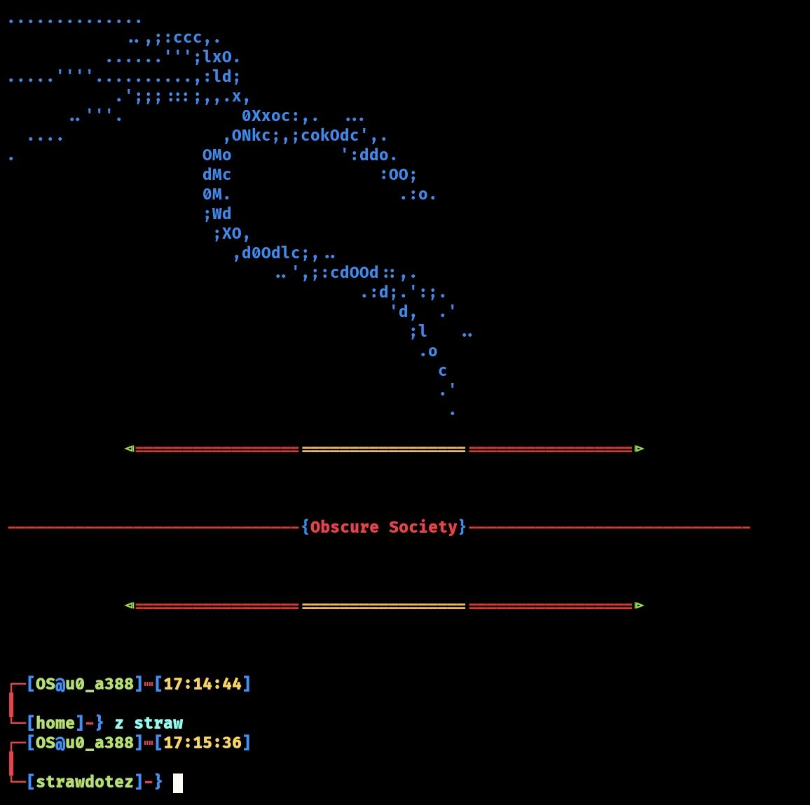
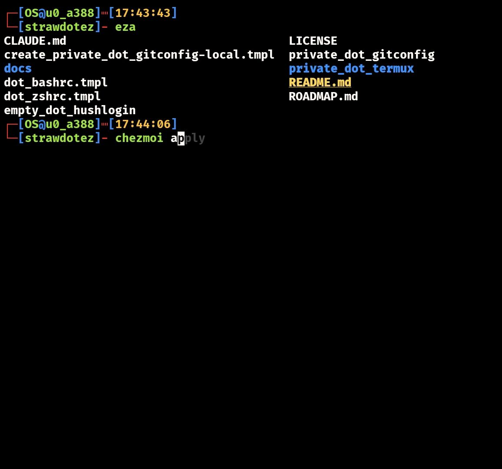

<div align="center">

# strawdotez

**Your whole Termux setup in one command.**
Shell, packages, theme, font and shortcuts, for phone and tablet.


**English** · [Português](README.pt-BR.md)

</div>

---

## Highlights

- **One command** installs everything and can be re-run safely.
- **Fast:** bash opens in about 15ms and zsh in about 30ms (measured on a phone).
- **bash and zsh** share the same aliases and functions, written once.
- **Screen profiles** for phone and tablet, switched with a command.
- **Customizable** through install questions: language, name, email, profile, logo and header, and the Termux welcome message.
- **No secrets** in the repository.

## Preview

| bash | zsh |
|------|-----|
|  |  |

## Install

In Termux (preferably the [F-Droid](https://f-droid.org/packages/com.termux/) build):

```bash
pkg install -y chezmoi git
chezmoi init --apply lukymew/strawdotez
```

Or in one line:

```bash
curl -fsSL https://raw.githubusercontent.com/lukymew/strawdotez/main/install.sh | bash
```

Add `-s -- --defaults` after `bash` to skip the questions and use the defaults.

To install a specific release instead of `main`, add `--version v1.2.0` (`... | bash -s -- --version v1.2.0`). A pinned install does not move with `straw update`; run the installer again to change version.

Want to read the installer before running it? See [SECURITY.md](SECURITY.md#checking-the-installer-before-running-it-optional).

It asks a few questions (Enter accepts each default):

| Question | What it does |
|---|---|
| Language | `pt` or `en` (messages and notices) |
| Name for git | becomes git's `user.name` (optional) |
| Email for git | becomes git's `user.email` (optional) |
| Termux profile | `cell` (phone) or `tablet` |
| Logo and header | shows the logo when the terminal opens, or not |
| Termux welcome message | turns off the default message (`.hushlogin`) |

Then it installs the packages, downloads the zsh plugins and applies the settings. Open a new session to see the result.

## What you get

- **Packages:** zsh, git, neovim, micro, tmux, fzf, ripgrep, fd, bat, lazygit, eza, zoxide, gh, nodejs, python, openssh and more (the full list is in `.chezmoidata/packages.yaml`).
- **bash:** welcome logo and header, custom prompt, better history, and a hint for the right package when a command is missing.
- **zsh:** suggestions from history, syntax highlighting, completion and the same prompt as bash.
- **Tools:** `Ctrl+R` searches history with fzf and `z folder` jumps to the most used folder.
- **Handy functions:** `extract`, `genpasswd`, `his`, `xtop`, `mkcd`, network and file utilities.
- **Termux:** extra keys, colors, font and two interface profiles.

## Day to day

| Command | What it does |
|---|---|
| `chezmoi update` | pulls and applies the latest changes from the repo |
| `chezmoi diff` | shows what would change before applying |
| `termux-modo-tablet` | enables the tablet profile |
| `termux-modo-celular` | enables the phone profile |
| `crb` | restores Termux's `bash.bashrc` if it gets corrupted |
| `straw menu` | opens the menu: tools (package modules) and profiles |
| `straw install` | installs packages by name |
| `straw tools [search]` | interactive tool browser: live search, mark several, install (Go); with a search term it just lists matches |
| `straw doctor` | diagnoses the environment and package lists (Go) |
| `straw update` | pulls and applies the latest changes |

`straw tools` and `straw doctor` use the small Go binary `straw-ui`, which `install.sh` downloads from the latest release (sha256 checked). If the download fails, everything else keeps working in bash. To build it yourself:

```sh
pkg install golang
go build -o ~/.local/bin/straw-ui ./cmd/straw-ui
```

`STRAW_PLAIN=1` turns the menu emojis off.

## Layout

```text
.chezmoi.toml.tmpl          install questions
.chezmoidata/packages.yaml  package list
.chezmoidata/i18n.yaml      messages in Portuguese and English
.chezmoidata/straw.yaml     modules and profiles for `straw menu`
.chezmoiexternal.toml       zsh plugins downloaded from GitHub
cmd/ and internal/          Go part of `straw` (doctor and tools)
.chezmoiscripts/            installs packages, bash.bashrc and reloads Termux
.chezmoitemplates/          reusable pieces (aliases, functions, options)
dot_bashrc.tmpl             builds ~/.bashrc
dot_zshrc.tmpl              builds ~/.zshrc
private_dot_termux/         Termux properties, colors and font
```

## Customizing

- **Add a package:** put its name in `.chezmoidata/packages.yaml` and run `chezmoi apply`.
- **Add an alias:** edit `.chezmoitemplates/aliases_termux`.
- **Add a function:** use the matching file in `.chezmoitemplates/functions_*_termux`.
- **Add a message:** put it in `.chezmoidata/i18n.yaml` under both `pt` and `en`.
- **Change the banner title:** edit `banner_title` in `.chezmoidata/ui.yaml`, then run `chezmoi init` and `chezmoi apply`.
- **Change colors or font:** edit the files in `private_dot_termux/`.

See [Troubleshooting](docs/TROUBLESHOOTING.md) and [Contributing](CONTRIBUTING.md).

## Credits and inspirations

This project would not exist without other people's work:

- [**Dragon Bash**](https://github.com/SnowPerfectDev/Dragon-Bash) (SnowPerfectDev): base of the Termux bashrc.
- [**Gogh**](https://github.com/Mayccoll/Gogh): the Argonaut color theme.
- [**chezmoi**](https://www.chezmoi.io/): dotfile management.
- [**fzf**](https://github.com/junegunn/fzf) and [**zoxide**](https://github.com/ajeetdsouza/zoxide): search and navigation.
- [**eza**](https://github.com/eza-community/eza): a modern replacement for `ls`.
- [**zsh-autosuggestions**](https://github.com/zsh-users/zsh-autosuggestions) and [**zsh-syntax-highlighting**](https://github.com/zsh-users/zsh-syntax-highlighting): zsh plugins.
- [**Termux**](https://termux.dev/) and the [**GitHub CLI**](https://cli.github.com/).

## License

Released under the [MIT](LICENSE) license.
