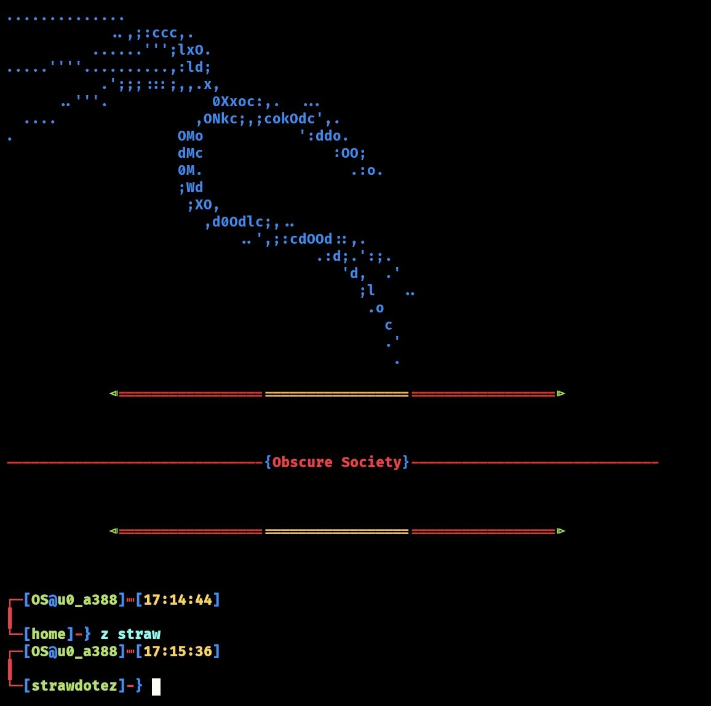
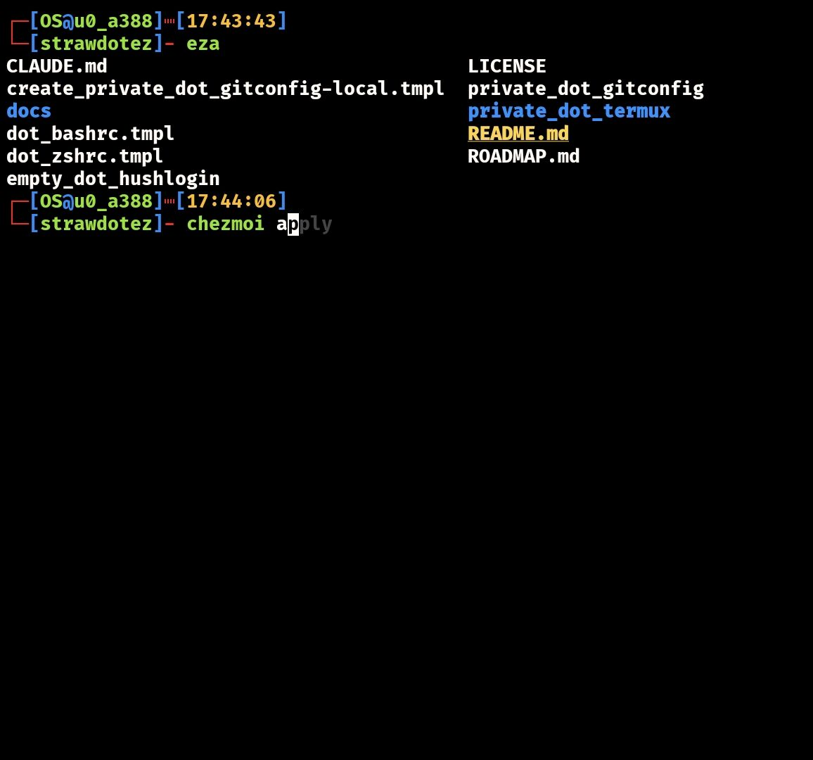

<div align="center">

# strawdotez

**Seu Termux completo em um comando.**
Shell, pacotes, tema, fonte e atalhos, para celular e tablet.


[English](README.md) · **Português**

</div>

---

## Destaques

- **Um comando** instala tudo e pode ser repetido sem quebrar nada.
- **Rápido:** o bash abre em cerca de 15ms e o zsh em cerca de 30ms (medido no celular).
- **Bash e zsh** com os mesmos aliases e funções, escritos uma vez só.
- **Perfis de tela** para celular e tablet, com troca por comando.
- **Personalizável** por perguntas na instalação: idioma, nome, e-mail, perfil, logo e cabeçalho, e mensagem de boas-vindas do Termux.
- **Sem segredos** no repositório.

## Prévia

| bash | zsh |
|------|-----|
|  |  |

## Instalação

No Termux (de preferência o do [F-Droid](https://f-droid.org/packages/com.termux/)):

```bash
pkg install -y chezmoi git
chezmoi init --apply lukymew/strawdotez
```

Ou em uma linha:

```bash
curl -fsSL https://raw.githubusercontent.com/lukymew/strawdotez/main/install.sh | bash
```

Coloque `-s -- --defaults` depois de `bash` para pular as perguntas e usar os padrões.

Para instalar uma versão específica em vez do `main`, acrescente `--version v1.2.0` (`... | bash -s -- --version v1.2.0`). Uma instalação fixada não muda com o `straw update`; rode o instalador de novo para trocar de versão.

Quer ler o instalador antes de rodar? Veja o [SECURITY.md](SECURITY.md#conferir-o-instalador-antes-de-rodar-opcional).

Ele faz algumas perguntas (Enter aceita o padrão de cada uma):

| Pergunta | Para que serve |
|---|---|
| Idioma | `pt` ou `en` (mensagens e avisos) |
| Nome para o git | vira o `user.name` do git (opcional) |
| E-mail para o git | vira o `user.email` do git (opcional) |
| Perfil do Termux | `cell` (celular) ou `tablet` |
| Logo e cabeçalho | mostra ou não o logo ao abrir o terminal |
| Boas-vindas do Termux | desliga a mensagem padrão (`.hushlogin`) |

Depois ele instala os pacotes, baixa os plugins do zsh e aplica as configurações. Abra uma sessão nova para ver o resultado.

## O que vem

- **Pacotes:** zsh, git, neovim, micro, tmux, fzf, ripgrep, fd, bat, lazygit, eza, zoxide, gh, nodejs, python, openssh e outros (a lista completa está em `.chezmoidata/packages.yaml`).
- **bash:** logo e cabeçalho de boas-vindas, prompt próprio, histórico melhorado, aviso de pacote quando um comando não existe.
- **zsh:** sugestões a partir do histórico, destaque de sintaxe, autocompletar e o mesmo prompt do bash.
- **Ferramentas:** `Ctrl+R` busca no histórico com fzf e `z pasta` pula para a pasta mais usada.
- **Funções úteis:** `extract`, `genpasswd`, `his`, `xtop`, `mkcd`, utilitários de rede e de arquivos.
- **Termux:** teclas extras, cores, fonte e dois perfis de interface.

## Uso no dia a dia

| Comando | O que faz |
|---|---|
| `chezmoi update` | baixa e aplica as novidades do repositório |
| `chezmoi diff` | mostra o que vai mudar antes de aplicar |
| `termux-modo-tablet` | ativa o perfil de tablet |
| `termux-modo-celular` | ativa o perfil de celular |
| `crb` | restaura o `bash.bashrc` do Termux se ele for corrompido |
| `straw menu` | abre o menu: ferramentas (módulos de pacotes) e perfis |
| `straw install` | instala pacotes pelo nome |
| `straw tools [busca]` | navegador interativo: busca ao vivo, marca várias e instala (Go); com um termo, só lista os resultados |
| `straw doctor` | diagnostica o ambiente e as listas de pacotes (Go) |
| `straw update` | baixa e aplica as novidades |

`straw tools` e `straw doctor` usam o binário pequeno `straw-ui`, em Go, que o `install.sh` baixa da última release (com conferência de sha256). Se o download falhar, o resto segue funcionando em bash. Para compilar você mesmo:

```sh
pkg install golang
go build -o ~/.local/bin/straw-ui ./cmd/straw-ui
```

`STRAW_PLAIN=1` desliga os emojis do menu.

## Estrutura

```text
.chezmoi.toml.tmpl          perguntas da instalação
.chezmoidata/packages.yaml  lista de pacotes
.chezmoidata/straw.yaml     módulos e perfis do `straw menu`
.chezmoiexternal.toml       plugins do zsh baixados do GitHub
cmd/ e internal/            parte em Go do `straw` (doctor e tools)
.chezmoiscripts/            instala pacotes, bash.bashrc e recarrega o Termux
.chezmoitemplates/          peças reutilizáveis (aliases, funções, opções)
dot_bashrc.tmpl             monta o ~/.bashrc
dot_zshrc.tmpl              monta o ~/.zshrc
private_dot_termux/         propriedades, cores e fonte do Termux
```

## Personalizando

- **Adicionar um pacote:** coloque o nome em `.chezmoidata/packages.yaml` e rode `chezmoi apply`.
- **Adicionar um alias:** edite `.chezmoitemplates/aliases_termux`.
- **Adicionar uma função:** use o arquivo do assunto em `.chezmoitemplates/functions_*_termux`.
- **Trocar o título do cabeçalho:** edite `banner_title` em `.chezmoidata/ui.yaml` e rode `chezmoi init` e `chezmoi apply`.
- **Trocar as cores ou a fonte:** edite os arquivos em `private_dot_termux/`.

Veja [Solução de problemas](docs/TROUBLESHOOTING.pt-BR.md) e [Contribuindo](CONTRIBUTING.md).

## Créditos e inspirações

Este projeto não existiria sem o trabalho de outras pessoas:

- [**Dragon Bash**](https://github.com/SnowPerfectDev/Dragon-Bash) (SnowPerfectDev): base do bashrc do Termux.
- [**Gogh**](https://github.com/Mayccoll/Gogh): o tema de cores Argonaut.
- [**chezmoi**](https://www.chezmoi.io/): gerenciamento dos dotfiles.
- [**fzf**](https://github.com/junegunn/fzf) e [**zoxide**](https://github.com/ajeetdsouza/zoxide): busca e navegação.
- [**eza**](https://github.com/eza-community/eza): substituto moderno do `ls`.
- [**zsh-autosuggestions**](https://github.com/zsh-users/zsh-autosuggestions) e [**zsh-syntax-highlighting**](https://github.com/zsh-users/zsh-syntax-highlighting): plugins do zsh.
- [**Termux**](https://termux.dev/) e o [**GitHub CLI**](https://cli.github.com/).

## Licença

Distribuído sob a licença [MIT](LICENSE).
